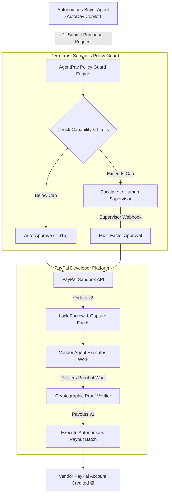

# 🤖 AgentPay AI — Autonomous Agentic Commerce & Escrow Protocol

[](https://developer.paypal.com)
[](https://paypalaihackathon.devpost.com)
[-00CFDE?style=for-the-badge)](https://paypalaihackathon.devpost.com)
[](tests/test_protocol.py)
[](render.yaml)
[](LICENSE)

> **"Autonomous agents shouldn't hold unmonitored credit cards. AgentPay allows multi-agent swarms to safely procure compute, datasets, and API tools within cryptographic human policy limits using PayPal Sandbox."**

---

## 💡 The Problem & Inspiration
In 2026, the artificial intelligence paradigm has shifted from isolated chatbots to **autonomous multi-agent meshes** (autonomous coders, research bots, synthetic data generators, and GPU brokers). 
To produce real-world results, these agents must trade with one another:
- A coding agent needs to rent an H100 GPU node for 15 minutes.
- A research agent needs to license a proprietary domain dataset.
- A deployment agent needs to pay for an automated penetration test.

**The Catastrophic Vulnerability:**
Developers cannot give autonomous agents unrestricted corporate credit cards or direct banking credentials. Runaway token recursion loops, prompt injection exploits, or unverified vendors can drain thousands of dollars in minutes.

---

## 🛡️ The Solution: AgentPay Protocol
**AgentPay AI** introduces a zero-trust, semantic governance layer connecting multi-agent swarms directly to the **PayPal Developer Platform**:

1. **Semantic Spending Policies:** Humans set daily budget caps, per-transaction maximums, and allowed capability whitelists (e.g., `GPU_COMPUTE`, `DATASET_LICENSE`).
2. **Instant Micro-Escrow (PayPal Orders v2):** When an agent initiates a purchase within pre-approved limits, AgentPay automatically provisions a PayPal Sandbox Order and captures funds into an escrow vault.
3. **Human-in-the-Loop Escalation:** Any request that exceeds transaction caps, surpasses daily budgets, or requests unapproved capabilities is paused with status `ESCALATED_TO_HUMAN` for supervisor sign-off.
4. **Cryptographic Proof & Autonomous Payout (PayPal Payouts v1):** Once the vendor agent delivers cryptographic proof of work (e.g., model weight hashes or AST audit diffs), AgentPay verifies the hash and immediately dispatches automated payout batches to the vendor's PayPal email.

---

## 🏗️ Architecture & Technology Stack



### Core Technologies
- **PayPal Developer APIs:**
  - **Orders v2:** `POST /v2/checkout/orders` & `POST /v2/checkout/orders/{id}/capture` for automated escrow locking.
  - **Payouts v1:** `POST /v1/payments/payouts` for autonomous vendor disbursement upon verified work.
  - **OAuth 2.0:** Secure client credentials token caching.
- **Backend Framework:** FastAPI (Python 3.10), Pydantic v2 schemas, Jinja2 templates.
- **Frontend Command Center:** Tailwind CSS, responsive glassmorphism dark mode, real-time telemetry.
- **Deployment:** Render Web Service blueprint (`render.yaml`).

---

## 🚀 Quickstart & Local Setup

### 1. Clone & Install Dependencies
```bash
git clone https://github.com/satanic47/agentpay-ai.git
cd agentpay-ai
pip install -r requirements.txt
```

### 2. Configure Environment Variables
Copy `.env.example` to `.env`:
```bash
cp .env.example .env
```
Add your **PayPal Sandbox Client ID & Secret** from [developer.paypal.com](https://developer.paypal.com/dashboard/applications/sandbox).

### 3. Run the Application
```bash
uvicorn app:app --reload --port 8000
```
Open [http://localhost:8000](http://localhost:8000) in your browser.

### 4. Run the Pytest Suite
```bash
python -m pytest tests/ -v
```

---

## 🏆 Hackathon Alignment & Track Checklist
- [x] **Meaningful PayPal Integration:** Leverages both Orders v2 (Escrow lock) and Payouts v1 (Disbursement) inside an end-to-end automated financial loop.
- [x] **Agentic Commerce Track ($5,000):** Addresses the exact safety and transaction protocol needed for the 2026 autonomous agent economy.
- [x] **Render Cloud Sponsor Award ($2,250):** Packaged with declarative `render.yaml` for instantaneous 1-click cloud deployment.
- [x] **Open-Source MIT License & Documentation:** 100% compliant with Devpost submission guidelines.

---

## 📄 License
This project is licensed under the MIT License — see the [LICENSE](LICENSE) file for details.
